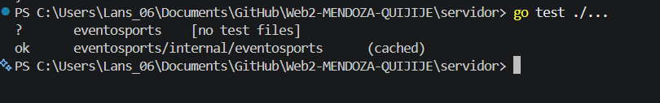
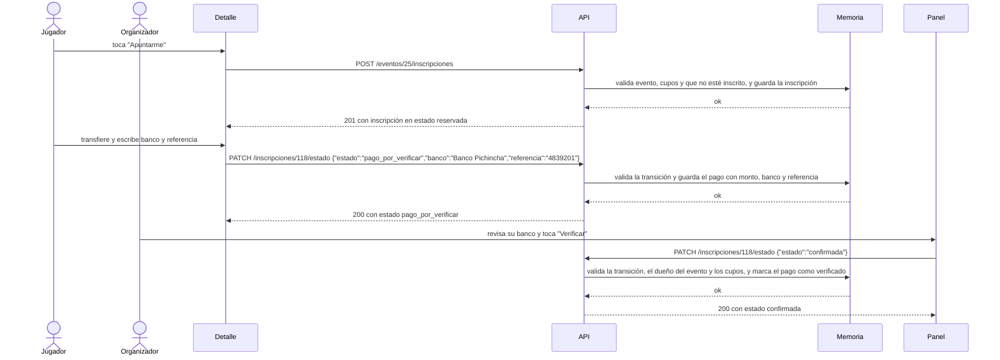
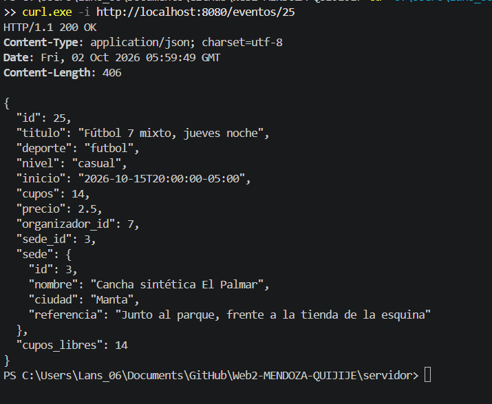

# Hito 1 · Addendum técnico

**Grupo:** E

**Pareja:** Sebastián Mendoza · Evelin Quijije

**Paralelo:** Aplicaciones Web II A

## A. Estructura del proyecto

Los cinco structs del modelo están en la [sección 4 de la ficha](hito1_ficha_del_negocio.md#4-modelo-de-datos) y en [`servidor/internal/eventosports/modelos.go`](../servidor/internal/eventosports/modelos.go).

```
.
├── servidor/                             API de EventoSports
│   ├── main.go                           arranque: lee PORT y levanta el servidor
│   ├── go.mod                            módulo eventosports, sin dependencias externas
│   ├── .env.example                      nombres de las variables de entorno, sin datos reales
│   ├── .gitignore                        excluye .env y binarios
│   └── internal/
│       └── eventosports/
│           ├── modelos.go                structs Usuario, Sede, Evento, Inscripcion y Pago (sección 4 de la ficha)
│           ├── validaciones.go           listas cerradas (deporte, nivel, estado) y tabla de transiciones permitidas
│           ├── manejadores.go            los seis endpoints de la sección 7, con datos en memoria
│           ├── rutas.go                  registro de rutas y verbos
│           └── manejadores_test.go       pruebas con httptest que corren sin base de datos
└── Documentacion/
    ├── hito1_ficha_del_negocio.md
    ├── hito1_addendum.md
    ├── hito1_presentacion.pptx
    ├── hito1_presentacion.pdf
    └── imagenes/
        ├── hito1_boceto.png               boceto del panel
        ├── hito1_pruebas.png              captura real de go test ./...
        └── hito1_respuesta_api.png        captura real de GET /eventos/25
```

## B. Configuración y secretos

| Variable | Para qué sirve | Ejemplo (sin datos reales) |
|----------|----------------|----------------------------|
| `PORT` | Puerto en el que escucha el servidor (si no existe, usa 8080) | `8080` |

Hoy no hay cadena de conexión: los datos viven en memoria y se pierden al apagar el servidor. Cuando se conecte PostgreSQL se agregará `DATABASE_URL`, y para el inicio de sesión una clave de firma.

**Archivo de ejemplo:** `servidor/.env.example`. El `.env` real está en `servidor/.gitignore` y el repositorio no contiene credenciales.

## C. Pruebas

Las pruebas cubren validaciones de error y recorridos correctos. Se ejecutan con `go test ./...` dentro de `servidor/`.

| Prueba | Qué caso cubre |
|--------|----------------|
| 1. `TestCrearEvento_JSONRoto` | `POST /eventos` con cuerpo mal formado responde 400. |
| 2. `TestCambiarEstado_FueraDeLaLista` | `PATCH /inscripciones/118/estado` con `{"estado":"vip"}` responde 422. |
| 3. `TestTransicion_CanceladaAConfirmada` | La tabla de transiciones de `validaciones.go` rechaza `cancelada → confirmada` (el manejador responde 409). |
| 4. `TestCrearEvento_CuposCero` | `POST /eventos` con `cupos: 0` responde 422. |
| 5. `TestVerEvento_IdNoNumerico` | `GET /eventos/abc` responde 400. |
| 6. `TestCrearEvento_RolJugador` | `POST /eventos` con `X-Rol: jugador` responde 403. |
| 7. `TestListarEventos_DosSemillas` | `GET /eventos` responde 200 con los eventos 25 y 26 ordenados. |
| 8. `TestCrearEvento_OK` | Un organizador crea un evento válido y recibe 201. |
| 9. `TestInscripcion_PagoYVerificacion` | El jugador envía la transferencia y el organizador confirma el pago. |

**Ejecución comprobada:** desde `servidor/`, `go test ./...` terminó correctamente el 2 de octubre de 2026:

```text
?   eventosports                     [no test files]
ok  eventosports/internal/eventosports  (cached)
```

La captura muestra el comando y su resultado en la terminal de Visual Studio Code:



## D. Boceto de la pantalla principal

Pantalla **Panel del organizador**, que consume el listado `GET /eventos/25/inscripciones`. Cada fila muestra el jugador, el **estado** de su inscripción (insignia de color: reservada, pago por verificar, confirmada o cancelada), el banco y la referencia de la transferencia y el monto. Los botones **Verificar**, **Rechazar** y **Cancelar** llaman a `PATCH /inscripciones/{id}/estado`. La pantalla de los jugadores, *Explorar eventos*, lista eventos con `GET /eventos` y no muestra estado porque los eventos no lo tienen: el estado de la inscripción se ve en este panel y en el *Detalle del evento*.


## E. Diagrama de secuencia del caso de uso principal

Caso: un jugador reserva cupo en un evento de pago y el organizador verifica la transferencia. En este hito la API guarda los datos en memoria; PostgreSQL todavía no está conectado.



## F. Respuesta real de la API

La captura real muestra la petición `curl.exe -i http://localhost:8080/eventos/25`, el código `HTTP/1.1 200 OK` y el cuerpo JSON del evento 25 en la misma terminal:


