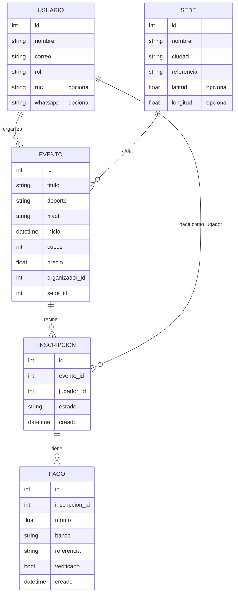
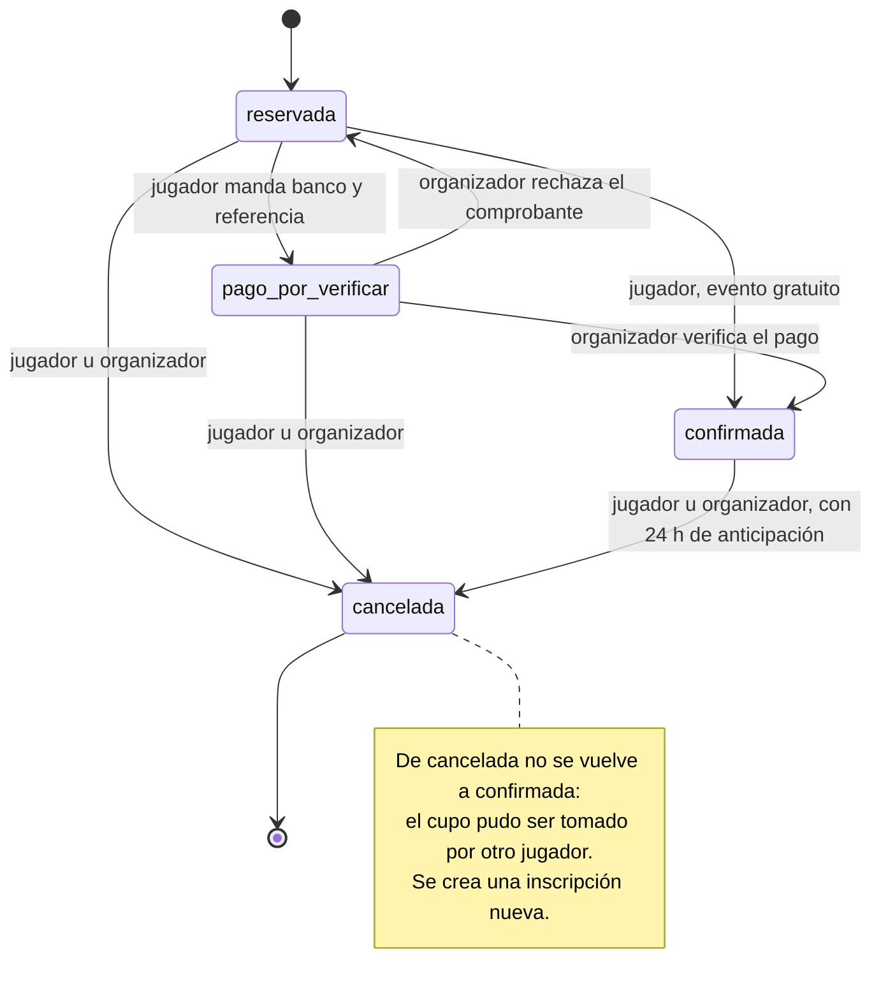

# Hito 1 · Ficha del negocio

**Grupo:** E

**Pareja:** Sebastián Mendoza · Evelin Quijije

**Paralelo:** Aplicaciones Web II A
**Negocio en una línea:** EventoSports es una plataforma donde organizadores y equipos publican partidos y torneos locales (fútbol, pádel y otros) y los jugadores reservan cupo y pagan por transferencia.

## 1. Negocio de referencia

**EventBookings** (fundador: Mark Thomas) es una plataforma para que organizadores de eventos —deportivos, comunitarios, benéficos y corporativos— publiquen su evento, vendan entradas y registren asistentes en un solo lugar. El cliente que paga es el organizador, no el asistente: se registra gratis, puede crear eventos de prueba y después contrata un plan de suscripción con precio bajo frente a los grandes competidores.

En su entrevista de Starter Story el fundador declara ingresos de 52.183 dólares al mes (cifra de enero de 2023; el título de la página habla de 120.000 al año), más de 10.000 eventos creados por unos 1.500 organizadores y más de un millón en entradas vendidas durante el primer año.

Nos sirve de referencia porque ataca el mismo problema que EventoSports (eventos que hoy se organizan con mensajes sueltos) y muestra que el ingreso está en el organizador, que repite cada semana, y no en el asistente ocasional. Las cifras las declara el propio fundador, nadie las audita, y el canal solo muestra negocios que salieron bien.

**Enlace:** [How I Built A $120K/Year Event Booking Platform · Starter Story](https://www.starterstory.com/stories/eventbookings)

## 2. Caso de contraste

**Sportaneous** (Nueva York, 2010) era un sitio web y una app para organizar partidos deportivos improvisados: el usuario entraba con Facebook, veía partidos cercanos o proponía uno. En septiembre de 2011 tenía unos 3.600 usuarios registrados, casi todos alrededor de la Universidad de Columbia, se organizaba aproximadamente un partido cada dos días y, según el diario de la Universidad de Pensilvania, no había generado dinero para sus fundadores. Después cambió de giro hacia actividades de fitness locales.

**Hipótesis:** la diferencia de fondo es el modelo de cobro. En Sportaneous el partido era gratis y lo armaban los propios jugadores, así que no había una transacción de la que cobrar ni un cliente que pagara; el valor dependía de juntar suficientes usuarios por barrio para tener partidos a diario. EventBookings, en cambio, cobra al organizador una suscripción por una herramienta que usa cada semana. Por eso EventoSports pone al organizador como cliente y cobra por evento pagado y por plan, no al jugador por entrar.

**Fuente:** [The Daily Pennsylvanian, 2011](https://www.thedp.com/article/2011/09/mobile_app_sportaneous_finds_pickup_games) · [Greatist, sobre el cambio de giro](https://greatist.com/fitness/sportaneous-app)

## 3. Adaptación al Ecuador

1. **Se paga por transferencia y se envía la foto del comprobante.** En Ecuador muchos jugadores de ligas barriales no pagan con tarjeta en internet: transfieren desde su banco o app y mandan captura por WhatsApp. Efecto: una reserva con precio no puede quedar «confirmada» al instante; necesita verificación del organizador antes de contar como cupo.
2. **Muchos organizadores son informales y no tienen RUC.** Dueños de canchas y organizadores de ligas suelen operar sin RUC, mientras que nosotros, para cobrar comisión, sí debemos estar en el SRI (RUC, régimen RIMPE) y emitir factura. Efecto: el RUC del organizador es un dato opcional; la comisión se calcula sobre los pagos verificados y se factura al organizador con su RUC o, si no lo tiene, con su cédula.
3. **Muchas canchas fuera de Guayaquil y Quito no tienen dirección estándar.** En ciudades como Manta se ubica una cancha por referencia («junto al parque, frente a la tienda») y la señal móvil es irregular, así que un mapa con coordenadas no basta. Efecto: la sede lleva una referencia de texto obligatoria y las coordenadas son opcionales.

**Qué cambió en el modelo por estas restricciones:** la restricción 1 agregó el estado `pago_por_verificar` a la inscripción, la entidad `Pago` (monto, banco y referencia de la transferencia) y el permiso del organizador para verificar o rechazar comprobantes. La restricción 2 agregó el atributo opcional `ruc` a `Usuario` (la cédula para facturar se pedirá al emitir la factura, fuera de este hito). La restricción 3 hizo obligatoria la `referencia` de `Sede` y opcionales `latitud` y `longitud`.

## 4. Modelo de datos

### Entidad: Usuario

| Atributo | Tipo | Obligatorio | Ejemplo |
|----------|------|-------------|---------|
| id | número entero | sí | 7 |
| nombre | texto | sí | Club Deportivo Manta Norte |
| correo | texto | sí | manta.norte@correo.com |
| rol | uno de: jugador, organizador | sí | organizador |
| ruc | texto | no | 1391234567001 |
| whatsapp | texto | no | 0991234567 |

### Entidad: Sede

| Atributo | Tipo | Obligatorio | Ejemplo |
|----------|------|-------------|---------|
| id | número entero | sí | 3 |
| nombre | texto | sí | Cancha sintética El Palmar |
| ciudad | texto | sí | Manta |
| referencia | texto | sí | Junto al parque, frente a la tienda de la esquina |
| latitud | número decimal | no | -0.9677 |
| longitud | número decimal | no | -80.7089 |

### Entidad: Evento

| Atributo | Tipo | Obligatorio | Ejemplo |
|----------|------|-------------|---------|
| id | número entero | sí | 25 |
| titulo | texto | sí | Fútbol 7 mixto, jueves noche |
| deporte | uno de: futbol, padel, tenis, basquet, natacion | sí | futbol |
| nivel | uno de: casual, amateur, competitivo | sí | casual |
| inicio | fecha y hora | sí | 15-10-2026 20:00 |
| cupos | número entero | sí | 14 |
| precio | número decimal | sí | 2.50 |
| organizador | referencia a Usuario | sí | 7 |
| sede | referencia a Sede | sí | 3 |

### Entidad: Inscripción

| Atributo | Tipo | Obligatorio | Ejemplo |
|----------|------|-------------|---------|
| id | número entero | sí | 118 |
| evento | referencia a Evento | sí | 25 |
| jugador | referencia a Usuario | sí | 12 |
| estado | uno de: reservada, pago_por_verificar, confirmada, cancelada | sí | reservada |
| creado | fecha y hora | sí | 10-10-2026 18:42 |

### Entidad: Pago

| Atributo | Tipo | Obligatorio | Ejemplo |
|----------|------|-------------|---------|
| id | número entero | sí | 60 |
| inscripcion | referencia a Inscripción | sí | 118 |
| monto | número decimal | sí | 2.50 |
| banco | texto | sí | Banco Pichincha |
| referencia | texto | sí | 4839201 |
| verificado | sí/no | sí | no |
| creado | fecha y hora | sí | 10-10-2026 19:05 |

### Relaciones

| Entidades | Cardinalidad | Frase |
|-----------|--------------|-------|
| Usuario – Evento | 1 a N | Un usuario organizador publica muchos eventos; cada evento tiene un solo organizador. |
| Sede – Evento | 1 a N | En una sede se juegan muchos eventos; cada evento se juega en una sola sede. |
| Evento – Inscripción | 1 a N | Un evento recibe muchas inscripciones; cada inscripción es de un solo evento. |
| Usuario – Inscripción | 1 a N | Un jugador tiene muchas inscripciones; cada inscripción es de un solo jugador. |
| Inscripción – Pago | 1 a N | Una inscripción puede tener varios comprobantes (si se rechaza uno y se reenvía); cada pago pertenece a una sola inscripción. |

### Structs en Go

```go
type Usuario struct {
    ID       uint    `gorm:"primaryKey" json:"id"`
    Nombre   string  `gorm:"not null" json:"nombre"`
    Correo   string  `gorm:"not null;uniqueIndex" json:"correo"`
    Rol      string  `gorm:"not null" json:"rol"` // jugador | organizador
    RUC      *string `json:"ruc,omitempty"`
    WhatsApp *string `json:"whatsapp,omitempty"`
}

type Sede struct {
    ID         uint     `gorm:"primaryKey" json:"id"`
    Nombre     string   `gorm:"not null" json:"nombre"`
    Ciudad     string   `gorm:"not null" json:"ciudad"`
    Referencia string   `gorm:"not null" json:"referencia"`
    Latitud    *float64 `json:"latitud,omitempty"`
    Longitud   *float64 `json:"longitud,omitempty"`
}

type Evento struct {
    ID            uint      `gorm:"primaryKey" json:"id"`
    Titulo        string    `gorm:"not null" json:"titulo"`
    Deporte       string    `gorm:"not null" json:"deporte"` // futbol | padel | tenis | basquet | natacion
    Nivel         string    `gorm:"not null" json:"nivel"`   // casual | amateur | competitivo
    Inicio        time.Time `gorm:"not null" json:"inicio"`
    Cupos         int       `gorm:"not null" json:"cupos"`
    Precio        float64   `gorm:"type:numeric(8,2);not null;default:0" json:"precio"`
    OrganizadorID uint      `gorm:"not null" json:"organizador_id"`
    SedeID        uint      `gorm:"not null" json:"sede_id"`
}

type Inscripcion struct {
    ID        uint      `gorm:"primaryKey" json:"id"`
    EventoID  uint      `gorm:"not null;index" json:"evento_id"`
    JugadorID uint      `gorm:"not null;index" json:"jugador_id"`
    Estado    string    `gorm:"not null;default:reservada" json:"estado"` // reservada | pago_por_verificar | confirmada | cancelada
    Creado    time.Time `gorm:"autoCreateTime" json:"creado"`
}

type Pago struct {
    ID            uint      `gorm:"primaryKey" json:"id"`
    InscripcionID uint      `gorm:"not null" json:"inscripcion_id"`
    Monto         float64   `gorm:"type:numeric(8,2);not null" json:"monto"`
    Banco         string    `gorm:"not null" json:"banco"`
    Referencia    string    `gorm:"not null" json:"referencia"`
    Verificado    bool      `gorm:"not null;default:false" json:"verificado"`
    Creado        time.Time `gorm:"autoCreateTime" json:"creado"`
}
```

**Decisión de tipos que tuvimos que pensar:** `Inicio` es `time.Time` y no texto para poder comparar «el evento ya empezó» y «faltan al menos 24 h» sin convertir cadenas. `Latitud`, `Longitud`, `RUC` y `WhatsApp` son punteros porque son opcionales y un `0` o un texto vacío no significa «no hay dato» (la latitud 0 existe). `Precio` y `Monto` son `float64` mapeados a `numeric(8,2)` porque los precios son de pocos dólares con centavos y en este hito no sumamos montos; si más adelante hay reportes de ingresos, se revisará por centavos enteros.

**Dónde se validan las listas cerradas y la inscripción repetida:** Los campos «uno de» (`Rol`, `Deporte`, `Nivel`, `Estado`) son `string` en Go y su lista cerrada se valida en `validaciones.go` antes de tocar la base de datos. `Inscripcion` no tiene índice único por (evento, jugador) porque, tras cancelar, el jugador puede inscribirse otra vez: la regla es «no tener ya una inscripción activa» (reservada, pago_por_verificar o confirmada) y se valida en el código.

### Diagrama del modelo completo



**Decisión discutible del modelo y por qué la tomamos:** `Pago` es una entidad y no dos campos de `Inscripcion` (banco y referencia), porque un comprobante puede ser rechazado y el jugador manda otro: una inscripción tiene varios pagos y necesitamos conservar el historial de lo que se verificó. Además, `Inscripcion` es la entidad con estados y no `Evento`, porque lo que cambia con el tiempo y con el pago es la reserva de cada jugador; el deporte y el nivel del evento son categorías que no cambian.

## 5. Máquina de estados

**Entidad con estados:** Inscripción (la reserva de un jugador en un evento)

| Estado | Qué significa |
|--------|---------------|
| reservada (inicial) | El jugador se apuntó, pero aún no tiene cupo asegurado: falta pagar o el organizador rechazó el comprobante. |
| pago_por_verificar | El jugador transfirió y subió banco y referencia; el organizador debe comparar con su banco. |
| confirmada | Cupo asegurado: evento gratuito o pago verificado. Cuenta contra `cupos`. |
| cancelada | La inscripción se anuló; el cupo queda libre. Estado final. |

| De | A | Quién la hace | Condición |
|----|---|---------------|-----------|
| reservada | pago_por_verificar | jugador | El evento tiene precio mayor que 0 y el jugador manda banco y referencia de la transferencia. |
| reservada | confirmada | jugador | El evento es gratuito (precio 0) y quedan cupos. |
| pago_por_verificar | confirmada | organizador | El comprobante coincide con el monto y quedan cupos. |
| pago_por_verificar | reservada | organizador | El comprobante no coincide; se rechaza y el jugador puede reenviar. |
| reservada | cancelada | jugador o organizador | El evento aún no ha empezado. |
| pago_por_verificar | cancelada | jugador o organizador | El evento aún no ha empezado; si había un comprobante, queda sin verificar. |
| confirmada | cancelada | jugador o organizador | Faltan al menos 24 horas para el inicio del evento. |

**Transición prohibida y por qué:** de `cancelada` no se vuelve a `confirmada`. Al cancelar, el cupo se libera y otro jugador pudo tomarlo; si el jugador quiere volver, hace una inscripción nueva, que respeta los cupos y la verificación del pago.

### Diagrama de estados



## 6. Roles y permisos

| Acción | Jugador | Organizador |
|--------|---------|-------------|
| Ver la lista y el detalle de eventos | todos | todos |
| Publicar un evento | no | sí |
| Inscribirse en un evento | sí | no |
| Mandar banco y referencia de la transferencia (reservada → pago_por_verificar) | solo los suyos | no |
| Confirmar un evento gratuito (reservada → confirmada) | solo los suyos | no |
| Verificar o rechazar un comprobante | no | solo los suyos |
| Cancelar una inscripción | solo los suyos | solo los suyos |
| Ver las inscripciones de un evento | no | solo los suyos |

«Solo los suyos» significa: para el jugador, sus propias inscripciones; para el organizador, los eventos que él publicó y las inscripciones de esos eventos.

## 7. Mapa de endpoints por rol

Identificación en la versión original del hito 1 (sustituida por JWT en el hito 2): el usuario y su rol llegan en los encabezados `X-Usuario-ID` y `X-Rol`; el inicio de sesión real es de un hito posterior.

| Endpoint | Rol que lo llama | Pantalla que lo consume | Qué devuelve | Qué valida | Código si falla |
|----------|------------------|-------------------------|--------------|------------|-----------------|
| `GET /eventos` | jugador, organizador | Explorar eventos | Lista de eventos con deporte, nivel, inicio, sede, precio y cupos libres; admite `?deporte=`, `?nivel=` y `?ciudad=` | Que `deporte` y `nivel` del filtro estén en su lista cerrada | 422 filtro fuera de la lista |
| `POST /eventos` | organizador | Publicar evento | 201 con el evento creado | JSON válido; título no vacío; deporte y nivel en su lista; cupos mayor que 0; precio no negativo; inicio en el futuro; sede existente; rol organizador | 400 JSON roto · 422 regla incumplida · 403 rol no permitido |
| `GET /eventos/{id}` | jugador, organizador | Detalle del evento | El evento con su sede, cupos libres y, si llama un jugador, su inscripción | Que `{id}` sea un número y el evento exista | 400 id no numérico · 404 no existe |
| `POST /eventos/{id}/inscripciones` | jugador | Detalle del evento | 201 con la inscripción en estado `reservada` | Que el evento exista y no haya empezado; que el jugador no tenga ya una inscripción activa en él; que queden cupos | 404 evento · 409 ya inscrito, evento ya empezado o sin cupos · 403 rol no permitido |
| `PATCH /inscripciones/{id}/estado` | jugador u organizador, según la transición | Detalle del evento (jugador) · Panel del organizador | 200 con la inscripción actualizada | Estado en la lista cerrada; transición permitida; que quien llama pueda hacerla; si pasa a `pago_por_verificar`, que vengan `banco` y `referencia` (el monto sale del precio del evento); cupos al confirmar; 24 h de anticipación para cancelar una confirmada | 400 JSON o id roto · 422 estado fuera de la lista o faltan banco y referencia · 409 transición prohibida, sin cupos o menos de 24 h para cancelar · 403 no es suya · 404 no existe |
| `GET /eventos/{id}/inscripciones` | organizador (dueño del evento) | Panel del organizador | Inscripciones del evento con jugador, estado y último pago | Que el evento sea del organizador que llama | 403 evento ajeno · 404 no existe |

**Cobertura de operaciones:** Evento: crear, listar y ver el detalle; Inscripción: crear, listar por evento y cambiar de estado (cancelar es un cambio de estado, no un borrado). Editar un evento y las altas de Usuario, Sede y Pago quedan fuera de estos seis y se harán en hitos posteriores.

### Matriz pantalla × endpoint

| Pantalla | GET /eventos | POST /eventos | GET /eventos/{id} | POST /eventos/{id}/inscripciones | PATCH /inscripciones/{id}/estado | GET /eventos/{id}/inscripciones |
|----------|--------------|---------------|-------------------|----------------------------------|----------------------------------|---------------------------------|
| Explorar eventos (ambos) | ✓ | | | | | |
| Publicar evento (organizador) | | ✓ | | | | |
| Detalle del evento (jugador) | | | ✓ | ✓ | ✓ | |
| Panel del organizador (organizador) | | | | | ✓ | ✓ |

**Endpoints que ya están funcionando y en qué archivo:** los seis, con los datos en memoria por ahora: las rutas están en `servidor/internal/eventosports/rutas.go`, los manejadores en `servidor/internal/eventosports/manejadores.go` y las listas cerradas y la tabla de transiciones en `servidor/internal/eventosports/validaciones.go`.


## Actualización del mapa para el Hito 2

El mapa anterior conserva el diseño original del hito 1. La implementación actual usa JWT, PostgreSQL y las capas de `servidor/internal/`. El contrato vigente es `docs/openapi.yaml`; la matriz completa está en `docs/hito2_hoja.md`. La transición prohibida ahora devuelve **422**. Los structs vigentes están en `servidor/internal/modelo/modelos.go`; el modelo de negocio y sus relaciones se conservan. La tabla `cuentas` se agregó exclusivamente para el login, separada de `usuarios`.

| Operación adicional | Estado | Motivo |
|---|---|---|
| `POST /login` | Implementada | Sesión exigida en S7 y Hito 2 |
| `GET /inscripciones/{id}` | Implementada | Consulta individual mínima de la entidad principal; solo dueños |
| `GET /usuarios` y `POST /usuarios` | Plan, sin código HTTP | Perfiles del negocio; no son registro ni CRUD de cuentas de sesión |
| `GET /sedes` y `POST /sedes` | Plan, sin código HTTP | Gestión futura de lugares |
| `GET /inscripciones/{id}/pagos` y `POST /inscripciones/{id}/pagos` | Plan, sin código HTTP | Gestión futura independiente del historial; hoy el comprobante se registra mediante el cambio de estado |

Todos los summaries de estas seis operaciones futuras terminan en `(plan)`. No se agregaron endpoints implementados para una tercera entidad.
