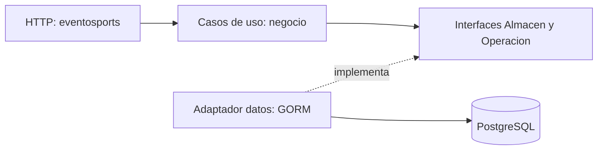

# Decisiones de EventoSports

## Semana 8 · estructura

Elegimos separar HTTP, negocio, datos y modelo en paquetes dentro de `servidor/internal`. Inscripción sigue siendo la entidad principal porque su estado representa la reserva y la verificación de pago; Evento es la entidad relacionada que ya tenía endpoints en el hito 1.

| Carpeta | Responsabilidad | Qué no hace |
|---|---|---|
| `eventosports/` | Rutas, lectura de JSON e ID, sesión y traducción de errores a códigos HTTP | No ejecuta consultas ni decide las transiciones |
| `negocio/` | Casos de uso, validaciones, propiedad, permisos por transición e interfaces del almacén | No importa `net/http`, GORM ni el adaptador de datos |
| `datos/` | GORM, PostgreSQL, consultas, bloqueos, transacciones, migración y semilla | No interpreta peticiones HTTP |
| `modelo/` | Los cinco structs del negocio y sus relaciones | No contiene manejadores ni casos de uso |
| `sesion/` | Los archivos de autenticación del docente: bcrypt, JWT y guardias | No decide las transiciones de Inscripción |
| `configuracion/` | Variables de entorno y lectura de `.env` | No contiene credenciales reales en el código |

El paquete `sesion` conserva la estructura del código entregado por el docente; la separación exigida para la entidad principal está en los cuatro primeros paquetes. No pretendemos que el manejador de login ya sea una arquitectura de capas independiente.

`main.go` conecta las piezas: entrega un `datos.AlmacenGORM` al servicio de negocio y entrega ese servicio al manejador HTTP. Las interfaces se declaran en `negocio/contratos.go`, porque el consumidor define qué necesita de la persistencia. El negocio no importa `datos`.

### Dos archivos que mostraremos

1. **`servidor/internal/eventosports/estado.go`**: recibe el ID y el JSON, llama a `Servicio.CambiarEstado` y escribe la respuesta. No contiene `DB`, `Where`, `First`, `Save` ni una transacción GORM.
2. **`servidor/internal/negocio/estados.go`**: `ValidarCambio` recibe inscripción, evento, actor, estado solicitado, ocupación y hora. Devuelve una decisión de negocio. No recibe `http.Request`, no escribe `http.ResponseWriter` y no usa códigos HTTP ni SQL.

La coordinación de la transacción está en `negocio/servicio.go`; su ejecución concreta y los bloqueos están en `datos/almacen_gorm.go`. El servicio bloquea primero el evento y después la inscripción. La prueba de concurrencia comprueba que dos jugadores no puedan confirmar el último cupo a la vez.

### Errores

El negocio devuelve tipos: `Regla`, `Prohibido`, `Conflicto` o `ErrNoExiste`. La capa HTTP los convierte en 422, 403, 409 y 404 respectivamente. El JSON roto y el ID inválido producen 400 en HTTP. Así, cambiar un código de respuesta no exige modificar la regla de estados.

### Qué cambiaría con otra base

Cambiaríamos el adaptador de `datos/`, las migraciones y la conexión en `main.go`; escribiríamos una implementación de las mismas interfaces. Las reglas de `negocio/estados.go`, los casos de uso y las rutas HTTP podrían mantenerse. La prueba pura de estados sigue ejecutándose sin base de datos.

## Alcance y contrato del Hito 2

- Se conservaron las seis operaciones que ya existían en el mapa del hito 1.
- Se añadió `GET /inscripciones/{id}` para cumplir el mínimo de consultar individualmente la entidad principal. Solo permite al jugador dueño o al organizador de su evento.
- Los modelos de Usuario, Sede, Evento, Inscripción y Pago y todas sus relaciones se migran. `cuentas` es una tabla adicional de sesión, separada de `usuarios`.
- Se documentaron como **`(plan)`** el listado y alta de perfiles, sedes e historial de pagos. No se programaron esos endpoints. Es una extensión del mapa futuro, no una afirmación de que esas rutas ya funcionan.
- No se programaron edición, borrado ni registro de cuentas. Cancelar una inscripción es un cambio de estado.

## Permisos por operación del negocio

El PATCH de Inscripción acepta ambos roles porque la ficha ya permite que un jugador cancele o envíe un comprobante y que un organizador verifique pagos. **La operación demostrada es pasar de `pago_por_verificar` a `confirmada`, exclusiva del organizador dueño.** Ana recibe 403; Luis recibe 200 con el mismo cuerpo. No restringimos todo el PATCH a organizador porque eso quitaría acciones legítimas del jugador.

La transición `cancelada → confirmada` está prohibida aun para Luis: responde 422. La petición está bien formada y el actor es dueño del evento; falla la regla, no la sintaxis ni la autenticación.

## Datos reproducibles y colección

La petición 0 de Bruno hace la preparación antes del turno: inicia ambas sesiones, crea dos eventos futuros, crea y cancela una reserva de respaldo y crea otra cuyo comprobante queda pendiente. La respuesta HTTP principal de la petición 0 es la creación de esa segunda inscripción, 201; su script posterior registra el comprobante. Cada petición auxiliar comprueba su resultado.

Los IDs y los tokens se conservan únicamente en variables de ejecución `bru.setVar`. No se escriben JWT en los archivos `.bru` ni en el entorno versionado. La petición 2 vuelve a iniciar sesión en vivo y obtiene el token usado en 3, 5 y 6. Las peticiones 4 y 5 comparten ID y cuerpo. La 6 usa otro registro ya cancelado. Ejecutar de nuevo la 0 prepara datos nuevos sin borrar datos anteriores.

## Uso de IA

La separación en capas, las pruebas, el contrato, los scripts, la colección y esta documentación se prepararon con asistencia de Codex. Los archivos de tokens y guardia provienen del material docente. La pareja debe revisar las decisiones y explicar el código con sus propias razones. No se fabricaron commits de ningún integrante ni se hizo push automáticamente.
