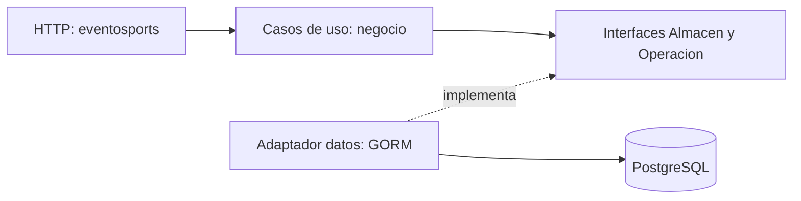

# Decisiones de EventoSports

## Semana 8 · estructura

Elegimos separar HTTP, negocio, datos y modelo en paquetes dentro de `servidor/internal`. Inscripción sigue siendo la entidad principal porque su estado representa la reserva y la verificación de pago; Evento es la entidad relacionada que ya tenía endpoints en el hito 1.

| Carpeta | Responsabilidad | Qué no hace |
|---|---|---|
| `eventosports/` | Rutas, lectura de JSON e ID, sesión y traducción de errores a códigos HTTP | No ejecuta consultas ni decide las transiciones |
| `negocio/` | Casos de uso, validaciones, propiedad, permisos por transición e interfaces del almacén | No importa `net/http`, GORM ni el adaptador de datos |
| `datos/` | GORM, PostgreSQL, consultas, bloqueos, transacciones, migración y semilla | No interpreta peticiones HTTP |
| `modelo/` | Los cinco structs del negocio y sus relaciones | No contiene manejadores ni casos de uso |
| `sesion/` | Los archivos de autenticación del docente: bcrypt, JWT y guardias | No decide las transiciones de Inscripción |
| `configuracion/` | Variables de entorno y lectura de `.env` | No contiene credenciales reales en el código |

El paquete `sesion` conserva la estructura del código entregado por el docente; la separación exigida para la entidad principal está en los cuatro primeros paquetes. No pretendemos que el manejador de login ya sea una arquitectura de capas independiente.

`main.go` conecta las piezas: entrega un `datos.AlmacenGORM` al servicio de negocio y entrega ese servicio al manejador HTTP. Las interfaces se declaran en `negocio/contratos.go`, porque el consumidor define qué necesita de la persistencia. El negocio no importa `datos`.

### Dos archivos que mostraremos

1. **`servidor/internal/eventosports/estado.go`**: recibe el ID y el JSON, llama a `Servicio.CambiarEstado` y escribe la respuesta. No contiene `DB`, `Where`, `First`, `Save` ni una transacción GORM.
2. **`servidor/internal/negocio/estados.go`**: `ValidarCambio` recibe inscripción, evento, actor, estado solicitado, ocupación y hora. Devuelve una decisión de negocio. No recibe `http.Request`, no escribe `http.ResponseWriter` y no usa códigos HTTP ni SQL.

La coordinación de la transacción está en `negocio/servicio.go`; su ejecución concreta y los bloqueos están en `datos/almacen_gorm.go`. El servicio bloquea primero el evento y después la inscripción. La prueba de concurrencia comprueba que dos jugadores no puedan confirmar el último cupo a la vez.

### Errores

El negocio devuelve tipos: `Regla`, `Prohibido`, `Conflicto` o `ErrNoExiste`. La capa HTTP los convierte en 422, 403, 409 y 404 respectivamente. El JSON roto y el ID inválido producen 400 en HTTP. Así, cambiar un código de respuesta no exige modificar la regla de estados.

### Qué cambiaría con otra base

Cambiaríamos el adaptador de `datos/`, las migraciones y la conexión en `main.go`; escribiríamos una implementación de las mismas interfaces. Las reglas de `negocio/estados.go`, los casos de uso y las rutas HTTP podrían mantenerse. La prueba pura de estados sigue ejecutándose sin base de datos.

## Alcance y contrato del Hito 2

- Se conservaron las seis operaciones que ya existían en el mapa del hito 1.
- Se añadió `GET /inscripciones/{id}` para cumplir el mínimo de consultar individualmente la entidad principal. Solo permite al jugador dueño o al organizador de su evento.
- Los modelos de Usuario, Sede, Evento, Inscripción y Pago y todas sus relaciones se migran. `cuentas` es una tabla adicional de sesión, separada de `usuarios`.
- Se documentaron como **`(plan)`** el listado y alta de perfiles, sedes e historial de pagos. No se programaron esos endpoints. Es una extensión del mapa futuro, no una afirmación de que esas rutas ya funcionan.
- No se programaron edición, borrado ni registro de cuentas. Cancelar una inscripción es un cambio de estado.

## Permisos por operación del negocio

El PATCH de Inscripción acepta ambos roles porque la ficha ya permite que un jugador cancele o envíe un comprobante y que un organizador verifique pagos. **La operación demostrada es pasar de `pago_por_verificar` a `confirmada`, exclusiva del organizador dueño.** Ana recibe 403; Luis recibe 200 con el mismo cuerpo. No restringimos todo el PATCH a organizador porque eso quitaría acciones legítimas del jugador.

La transición `cancelada → confirmada` está prohibida aun para Luis: responde 422. La petición está bien formada y el actor es dueño del evento; falla la regla, no la sintaxis ni la autenticación.

## Datos reproducibles y colección

La petición 0 de Bruno hace la preparación antes del turno: inicia ambas sesiones, crea dos eventos futuros, crea y cancela una reserva de respaldo y crea otra cuyo comprobante queda pendiente. La respuesta HTTP principal de la petición 0 es la creación de esa segunda inscripción, 201; su script posterior registra el comprobante. Cada petición auxiliar comprueba su resultado.

Los IDs y los tokens se conservan únicamente en variables de ejecución `bru.setVar`. No se escriben JWT en los archivos `.bru` ni en el entorno versionado. La petición 2 vuelve a iniciar sesión en vivo y obtiene el token usado en 3, 5 y 6. Las peticiones 4 y 5 comparten ID y cuerpo. La 6 usa otro registro ya cancelado. Ejecutar de nuevo la 0 prepara datos nuevos sin borrar datos anteriores.

## Semana 10 · PostgreSQL sin Docker

Usamos PostgreSQL 16 instalado en el equipo, en lugar del contenedor del hito 2, porque preferimos no depender de Docker para trabajar. El motor es el mismo, así que sqlc sigue siendo posible. La API se conecta con su propio usuario, `eventosports`, dueño de su base, y no con `postgres`, que tiene permiso sobre todo.

`servidor/compose.yaml` no se borró: por ahora no se usa, y el taller deja Docker para la semana 11.

## Uso de IA

La separación en capas, las pruebas, el contrato, los scripts, la colección y esta documentación se prepararon con asistencia de Codex. Los archivos de tokens y guardia provienen del material docente. La pareja debe revisar las decisiones y explicar el código con sus propias razones. No se fabricaron commits de ningún integrante ni se hizo push automáticamente.

En la semana 10, la preparación de PostgreSQL local y la línea de base se hicieron con asistencia de Claude Code.

## Semana 10 · transacciones

### D1 · El caso

Cuando un jugador envía el comprobante de una inscripción reservada, el servicio crea una fila en `pagos` y cambia la inscripción a `pago_por_verificar`. Si falla el segundo paso, quedaría un pago asociado a una inscripción todavía reservada. Ambas escrituras deben confirmarse o deshacerse juntas.

### D2 · Opciones que consideramos

1. Mantener `Almacen.Transaccion(ctx, función)` en la interfaz del negocio. Cada adaptador entrega una `Operacion` que usa una única transacción. El servicio puede probarse con un almacén falso y no importa GORM ni `database/sql`. El adaptador de sqlc tiene que asegurar que sus consultas se ejecuten en la conexión de esa transacción.
2. Llamar `CrearPago` y `GuardarEstado` por separado desde el servicio. Es sencillo de escribir, pero si la segunda llamada falla, la primera ya quedó confirmada y se rompe la atomicidad.

### D3 · La que elegimos y por qué

Elegimos la primera opción. El servicio ya coordinaba los bloqueos del evento y de la inscripción dentro de `Almacen.Transaccion`, necesarios para no sobrepasar el último cupo. Conservamos ese orden y la interfaz. En el adaptador GORM, las dos escrituras usan GORM. En `AlmacenSQLC`, `CrearPago` y `GuardarEstado` usan consultas generadas por sqlc sobre la conexión de la transacción activa. Una prueba contra PostgreSQL impide el cambio de estado después del alta del pago y comprueba que no persiste ninguna de las dos escrituras con ambos adaptadores.

### D4 · La que descartamos y por qué

Descartamos las llamadas independientes. En EventoSports permitirían que un comprobante quedara guardado mientras su inscripción siguiera en `reservada`, lo que confundiría la revisión del organizador. Compensar el fallo con otro `DELETE` podría fallar también y no preservaría los bloqueos usados para controlar los cupos.

### D5 · Con sqlc

Agregamos la tabla `pagos` al esquema que lee sqlc y la consulta `CrearPago` a `consultas.sql`. Regeneramos `filas` con sqlc. `consultaSQLC` implementa `CrearPago` y ya implementaba `GuardarEstado`. Ambas funciones generadas reciben el `ConnPool` de la transacción que abre el adaptador, por lo que comparten la misma transacción de PostgreSQL con las lecturas y los bloqueos existentes. La interfaz y el servicio permanecieron iguales. La documentación de sqlc muestra `WithTx` para asociar consultas a `*sql.Tx`; aquí se usa el `DBTX` generado con la conexión transaccional que GORM ya proporciona, porque este adaptador también conserva operaciones de GORM.

### D6 · Archivos

Se tocaron `servidor/db/schema.sql`, `servidor/db/consultas.sql`, el código generado en `servidor/internal/datos/filas/` y `servidor/internal/datos/almacen_sqlc.go`. Las pruebas están en `servidor/internal/eventosports/transaccion_test.go` y `servidor/internal/negocio/servicio_test.go`; su salida se guarda en `docs/taller10/error_forzado.txt`. Se actualizó este archivo de decisiones y `README.md` para explicar el resultado. El servicio, sus reglas, los manejadores, las rutas y `main.go` quedaron iguales en esta fase.
