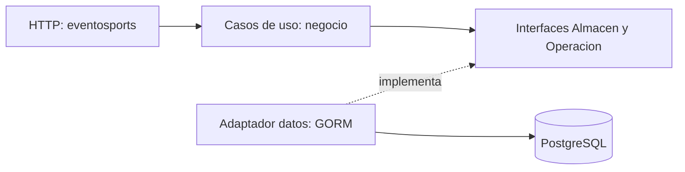

# Decisiones de EventoSports

## Semana 8 · estructura

Elegimos separar HTTP, negocio, datos y modelo en paquetes dentro de `servidor/internal`. Inscripción sigue siendo la entidad principal porque su estado representa la reserva y la verificación de pago; Evento es la entidad relacionada que ya tenía endpoints en el hito 1.

| Carpeta | Responsabilidad | Qué no hace |
|---|---|---|
| `eventosports/` | Rutas, lectura de JSON e ID, sesión y traducción de errores a códigos HTTP | No ejecuta consultas ni decide las transiciones |
| `negocio/` | Casos de uso, validaciones, propiedad, permisos por transición e interfaces del almacén | No importa `net/http`, GORM ni el adaptador de datos |
| `datos/` | GORM, PostgreSQL, consultas, bloqueos, transacciones, migración y semilla | No interpreta peticiones HTTP |
| `modelo/` | Los cinco structs del negocio y sus relaciones | No contiene manejadores ni casos de uso |
| `sesion/` | Los archivos de autenticación del docente: bcrypt, JWT y guardias | No decide las transiciones de Inscripción |
| `configuracion/` | Variables de entorno y lectura de `.env` | No contiene credenciales reales en el código |

El paquete `sesion` conserva la estructura del código entregado por el docente; la separación exigida para la entidad principal está en los cuatro primeros paquetes. No pretendemos que el manejador de login ya sea una arquitectura de capas independiente.

`main.go` conecta las piezas: entrega un `datos.AlmacenGORM` al servicio de negocio y entrega ese servicio al manejador HTTP. Las interfaces se declaran en `negocio/contratos.go`, porque el consumidor define qué necesita de la persistencia. El negocio no importa `datos`.

### Dos archivos que mostraremos

1. **`servidor/internal/eventosports/estado.go`**: recibe el ID y el JSON, llama a `Servicio.CambiarEstado` y escribe la respuesta. No contiene `DB`, `Where`, `First`, `Save` ni una transacción GORM.
2. **`servidor/internal/negocio/estados.go`**: `ValidarCambio` recibe inscripción, evento, actor, estado solicitado, ocupación y hora. Devuelve una decisión de negocio. No recibe `http.Request`, no escribe `http.ResponseWriter` y no usa códigos HTTP ni SQL.

La coordinación de la transacción está en `negocio/servicio.go`; su ejecución concreta y los bloqueos están en `datos/almacen_gorm.go`. El servicio bloquea primero el evento y después la inscripción. La prueba de concurrencia comprueba que dos jugadores no puedan confirmar el último cupo a la vez.

### Errores

El negocio devuelve tipos: `Regla`, `Prohibido`, `Conflicto` o `ErrNoExiste`. La capa HTTP los convierte en 422, 403, 409 y 404 respectivamente. El JSON roto y el ID inválido producen 400 en HTTP. Así, cambiar un código de respuesta no exige modificar la regla de estados.

### Qué cambiaría con otra base

Cambiaríamos el adaptador de `datos/`, las migraciones y la conexión en `main.go`; escribiríamos una implementación de las mismas interfaces. Las reglas de `negocio/estados.go`, los casos de uso y las rutas HTTP podrían mantenerse. La prueba pura de estados sigue ejecutándose sin base de datos.

## Alcance y contrato del Hito 2

- Se conservaron las seis operaciones que ya existían en el mapa del hito 1.
- Se añadió `GET /inscripciones/{id}` para cumplir el mínimo de consultar individualmente la entidad principal. Solo permite al jugador dueño o al organizador de su evento.
- Los modelos de Usuario, Sede, Evento, Inscripción y Pago y todas sus relaciones se migran. `cuentas` es una tabla adicional de sesión, separada de `usuarios`.
- Se documentaron como **`(plan)`** el listado y alta de perfiles, sedes e historial de pagos. No se programaron esos endpoints. Es una extensión del mapa futuro, no una afirmación de que esas rutas ya funcionan.
- No se programaron edición, borrado ni registro de cuentas. Cancelar una inscripción es un cambio de estado.

## Permisos por operación del negocio

El PATCH de Inscripción acepta ambos roles porque la ficha ya permite que un jugador cancele o envíe un comprobante y que un organizador verifique pagos. **La operación demostrada es pasar de `pago_por_verificar` a `confirmada`, exclusiva del organizador dueño.** Ana recibe 403; Luis recibe 200 con el mismo cuerpo. No restringimos todo el PATCH a organizador porque eso quitaría acciones legítimas del jugador.

La transición `cancelada → confirmada` está prohibida aun para Luis: responde 422. La petición está bien formada y el actor es dueño del evento; falla la regla, no la sintaxis ni la autenticación.

## Datos reproducibles y colección

La petición 0 de Bruno hace la preparación antes del turno: inicia ambas sesiones, crea dos eventos futuros, crea y cancela una reserva de respaldo y crea otra cuyo comprobante queda pendiente. La respuesta HTTP principal de la petición 0 es la creación de esa segunda inscripción, 201; su script posterior registra el comprobante. Cada petición auxiliar comprueba su resultado.

Los IDs y los tokens se conservan únicamente en variables de ejecución `bru.setVar`. No se escriben JWT en los archivos `.bru` ni en el entorno versionado. La petición 2 vuelve a iniciar sesión en vivo y obtiene el token usado en 3, 5 y 6. Las peticiones 4 y 5 comparten ID y cuerpo. La 6 usa otro registro ya cancelado. Ejecutar de nuevo la 0 prepara datos nuevos sin borrar datos anteriores.

## Uso de IA

La separación en capas, las pruebas, el contrato, los scripts, la colección y esta documentación se prepararon con asistencia de Codex. Los archivos de tokens y guardia provienen del material docente. La pareja debe revisar las decisiones y explicar el código con sus propias razones. No se fabricaron commits de ningún integrante ni se hizo push automáticamente.

## Semana 12 · la seguridad de la API

### D1 · Lo que encontramos y cerramos
La búsqueda con `docs/taller12/patrones.txt` dio 27 líneas: 21 arman SQL y 6 no (un grupo de rutas, dos mensajes de error, el correo de la siembra, la lectura de `r.URL.Query()` y la dirección del servidor). El texto del cliente llega al SQL por cuatro lugares: `?deporte=`, `?nivel=`, `?ciudad=` y el `usuario` del login. Los cuatro van como parámetro (`?`), y `deporte` y `nivel` además se comparan con una lista y responden 422 si no están. Los `{id}` se convierten con `strconv.ParseUint` antes de la consulta, y si no son números responden 400. El único `+` dentro de un SQL (`datos/base.go:55`) pega nombres de tabla fijos del código en la siembra, no texto del cliente. No había nada vulnerable, así que no se cambió código. La fila por fila está en `docs/taller12/auditoria.md`.

La prueba del paso 1.4 (`inyeccion.txt`): `?ciudad=Manta` devolvió 4 eventos; `?ciudad=' OR 1=1 --` devolvió `[]`, porque PostgreSQL buscó una ciudad que se llama literalmente así; `?deporte=' OR 1=1 --` dio 422; y `/inscripciones/1%20OR%201=1` dio 400. El mismo ataque quedó como prueba automática en `internal/eventosports/inyeccion_test.go`.

### D2 · El origen que puede leer nuestras respuestas
Nombramos `http://localhost:5173`, donde va a correr el front con Vite (todavía no lo tenemos). No usamos `"*"` porque cualquier página que abra un usuario podría llamar a la API desde su navegador y leer las respuestas. Con el origen nombrado, solo nuestro front recibe ese permiso. `AllowedMethods` lleva solo GET, POST y PATCH, los métodos que usa la API.

CORS va justo debajo de `chi.NewRouter()`, antes que todo, porque la petición previa (`OPTIONS`) no trae token: si pasara antes por el guardia recibiría 401, y metida en un `r.With` de las rutas daría 405 porque `OPTIONS` no tiene ruta propia. Por eso tampoco aparece en el registro de `middleware.Logger`, que va debajo: CORS la responde antes.

Desde `http://malo.example`, la previa respondió 200 sin ninguna cabecera `Access-Control-…`, y el PATCH hecho con curl desde ese origen se ejecutó igual: 200 y la inscripción 3 quedó `confirmada` (`cors_curl_ejecuta.txt`). CORS no es autenticación: lo aplica el navegador y curl o Bruno lo ignoran. Lo que protege el cambio de estado son el token y el rol. Cuando publiquemos el front, hay que agregar su origen exacto (con `https`, el dominio y sin barra final), mejor desde una variable de entorno que escrito en el código.

### D3 · El límite del login
El tope es de 5 intentos por minuto por IP, con la ventana deslizante de `httprate`. Una persona que se equivoca de clave lo hace una, dos o tres veces. Una vuelta de la colección de Bruno inicia sesión tres veces y entra en el tope. En cambio, sin límite, cada intento cuesta unos 65 ms de bcrypt, y un atacante podía probar cientos de claves por minuto. Con el tope, una IP prueba como mucho 5 por minuto.

Va solo en `POST /login`, con `r.With`, porque es la única ruta donde se adivinan contraseñas y la más cara (bcrypt). Con `r.Use` frenaría también las rutas normales, y las seis peticiones chocarían con el tope. Como la ruta está en `internal/eventosports/rutas.go`, el límite llega como un campo `LimiteLogin` del manejador: `main.go` pone el de `httprate` y las pruebas pueden armar el router sin él.

En la ráfaga (`rafaga.txt`), los cinco primeros intentos dieron 401 con `X-Ratelimit-Remaining` de 4 a 0. El primer 429 llegó en el sexto, con `Retry-After: 60`, y el séptimo dio lo mismo. En el registro, cada 401 tardó entre 64 y 79 ms y cada 429 salió en `0s`: lo responde el middleware sin llegar a bcrypt. La prueba `internal/eventosports/limite_test.go` comprueba lo mismo, y además que `GET /eventos` sigue respondiendo con el login frenado.

### D4 · Detrás de un proxy
`ClientIPFromRemoteAddr` saca la IP de `r.RemoteAddr`, la dirección de la conexión TCP (sin el puerto), y no lee ninguna cabecera. Por eso en el registro aparece `from ::1` en vez de `[::1]:60358`. Si la API queda detrás de un proxy (nginx, el balanceador de la nube), todas las conexiones llegan desde la IP del proxy. Todos los usuarios compartirían una sola cuenta, y cinco intentos fallidos de cualquiera bloquearían el login de todos durante un minuto.

No se puede confiar en `X-Forwarded-For` sin más porque la escribe el cliente: un atacante pondría un valor distinto en cada petición y nunca llegaría al tope. Lo correcto es aceptarla solo cuando la conexión viene del proxy que conocemos, y tomar la IP que agregó ese proxy. Chi 5.5.0 lo trae: `middleware.ClientIPFromXFF("rango/del/proxy")`, o `ClientIPFromXFFTrustedProxies(1)` si hay exactamente un proxy delante y la red garantiza que nadie más llega a la API.

### Uso de IA en la semana 12
Claude Code (Claude Opus 5.5) diagnosticó la conexión a PostgreSQL; corrió las búsquedas, las pruebas, la ráfaga y las peticiones de Bruno; escribió el código de CORS, del límite, del usuario de la base (reto) y de las pruebas nuevas; y redactó la auditoría y D1 a D7 a partir de esas salidas. Carlos aprobó cada comando. Las evidencias de `docs/taller12/` son las salidas tal como las dieron los comandos. La pareja tiene que revisar estas decisiones para poder defenderlas sin IA en el hito 3.

## Semana 12 · reto: mínimo privilegio en la base

### D5 · Con qué usuario se conecta la API
Con `eventosports_api` (el de `DATABASE_URL`). No es superusuario, no puede crear bases ni usuarios, no hereda permisos y no es dueño de ninguna tabla (`reto_usuarios.txt`). Su clave es aleatoria y vive solo en el `.env` de cada máquina. En el repositorio solo está el marcador de `.env.example`. Los permisos, tabla por tabla (`reto_permisos.txt`), son exactamente los que usa la API:

| Tabla | Permisos | Por qué |
| --- | --- | --- |
| `cuentas` | `SELECT` | El login lee nombre, rol y resumen de la clave; la siembra la hace el dueño |
| `usuarios`, `sedes` | `SELECT` | Perfiles, filtro `?ciudad=` y vista del evento; la API no los cambia |
| `eventos` | `SELECT`, `INSERT`, `UPDATE (cupos)` | El organizador crea eventos, pero la API nunca los cambia. `UPDATE (cupos)` está solo porque PostgreSQL pide UPDATE en alguna columna para `SELECT … FOR UPDATE`, el bloqueo que evita vender dos veces el último cupo |
| `inscripciones` | `SELECT`, `INSERT`, `UPDATE (estado)` | Reservar y cambiar el estado; ninguna otra columna se cambia |
| `pagos` | `SELECT`, `INSERT`, `UPDATE (verificado)` | Registrar el comprobante y verificarlo |
| `eventos_id_seq`, `inscripciones_id_seq`, `pagos_id_seq` | `USAGE` | Los `id` nuevos salen de la secuencia, que tiene su propio permiso |

Ninguna tabla tiene `DELETE`, `TRUNCATE`, `REFERENCES` ni `TRIGGER`. Al intentar borrar una tabla, PostgreSQL respondió `BEGIN`, `ERROR:  must be owner of table inscripciones` y `ROLLBACK` (`reto_drop.txt`). En `reto_otras_ordenes.txt`, `DELETE FROM inscripciones` y `UPDATE eventos SET titulo` dieron `permission denied`, `CREATE TABLE` dio `permission denied for schema public` y `CREATE ROLE` también se negó. Con este usuario, las seis peticiones siguen en 401, 200, 200, 403, 200 y 422.

### D6 · Quién crea y cambia las tablas
Las crea y las cambia `eventosports`, el usuario dueño que crea el contenedor de Compose (`MIGRACION_DATABASE_URL`). Eso pasa con `go run . -migrar`: se conecta como dueño, corre `AutoMigrate` y el índice único, siembra a Ana y Luis si `DEMO_SEED=true` y llama a `datos.PrepararUsuarioAPI`. Esa función crea `eventosports_api` (o le actualiza la clave), le quita todos los permisos y le vuelve a dar solo los de la lista. Si alguien agregó un permiso a mano, la siguiente migración lo borra. `-migrar` también se niega a seguir si `DATABASE_URL` usa al mismo dueño. Las pruebas de integración usan `MIGRACION_DATABASE_URL`, porque crean y borran su propio esquema.

`go run .` ya no corre `AutoMigrate`. Si cambiamos un modelo y arrancamos la API con su usuario sin migrar, la API arranca igual, pero las consultas que usen la columna nueva fallarían con 500 (la columna no existe) hasta que el dueño corra `go run . -migrar`. Esto lo razonamos, no lo probamos. Y si alguien volviera a poner `AutoMigrate` con el usuario de la API, PostgreSQL lo frenaría: crear una tabla da `permission denied for schema public`, y cambiar una existente pide ser dueño, como el `DROP` de `reto_drop.txt`. El orden desde cero es: `docker compose up -d --wait db`, `go run . -migrar` y `go run .`. Se probó primero sobre la base que ya teníamos y después desde un volumen vacío, con `docker compose down -v` y `docker compose up -d --wait db` (`reto_desde_cero.txt`). Sin migrar, `go run .` no pudo conectarse, porque `eventosports_api` todavía no existía. `go run . -migrar` creó las seis tablas, todas del dueño, y el usuario de la API. Después `go run .` arrancó, las seis peticiones pasaron y el `DROP` volvió a dar `must be owner of table inscripciones`. En esta rama Compose solo levanta la base (la API con Compose era del taller 11).

### D7 · Lo que esto no frena
Si quedara una inyección, quien la encuentre tendría los permisos de `eventosports_api`. Podría leer todo lo que la API lee, incluidos los resúmenes bcrypt de `cuentas` y los datos de los usuarios. También podría crear eventos e inscripciones, cambiar el estado de cualquier inscripción, marcar pagos como verificados y cambiar los `cupos` de un evento. Lo que ya no puede: borrar tablas o registros, vaciar tablas, crear tablas o usuarios, cambiar otras columnas, darse más permisos ni tocar la configuración del servidor. Eso lo podía hacer antes, cuando la API se conectaba como `eventosports`, que es superusuario. Tampoco cubre lo que PostgreSQL da a todos por defecto (`PUBLIC`), como conectarse a otras bases del mismo servidor o crear tablas temporales. La defensa principal sigue siendo la consulta con parámetros del punto 1; el mínimo privilegio limita el daño si esa falla.

## Semana 13 · los avisos en tiempo real

### D1 · Por qué WebSocket y no SSE ni sondeo
Avisamos al jugador cuando cambia el estado de **su inscripción**: el aviso `{"tipo":"estado_cambiado","id":…,"estado":…}` sale de `negocio.Servicio.CambiarEstado` y va en un solo sentido, del servidor al jugador. El caso que más importa es el pago por transferencia: ana sube el comprobante (`reservada` → `pago_por_verificar`) y espera a que luis lo verifique (`pago_por_verificar` → `confirmada`), lo que puede tardar minutos u horas. Con sondeo, la página tendría que pedir `GET /inscripciones/{id}` cada cierto tiempo: el aviso llega tarde (hasta el intervalo) y casi todas las peticiones vuelven sin novedad, pasando igual por el guardia y por PostgreSQL. Con 15 segundos son 4 peticiones por minuto por pestaña abierta, sin contar las del resto de la página.

Para nuestro front web (Vite, en `http://localhost:5173`), SSE bastaría: el aviso es de un solo sentido y `EventSource` se reconecta solo. Elegimos WebSocket porque el cliente del hito 3 va a ser web primero y después una app Android para los jugadores, que en Manta pagan por transferencia desde el celular. `EventSource` es del navegador; WebSocket tiene bibliotecas en Android y en cualquier plataforma, así que la misma ruta `/ws` sirve para los dos clientes. Lo que nos cuesta: el servidor ahora tiene estado (el mapa de `Avisos` en memoria, que vive en una sola copia de la API), la reconexión la tenemos que programar nosotros, el token viaja en la dirección y el origen lo tenemos que revisar en el servidor, porque CORS no se aplica al WebSocket. Además sumamos una dependencia, `github.com/coder/websocket` v1.8.15.

### D2 · Quién recibe cada aviso
La llave del mapa de `Avisos` (`servidor/internal/eventosports/avisos.go`) es el **id del usuario** (`uint`): `Conectar` lo saca de `sesion.Sesion.UsuarioID`, que es el `sub` del token. El dueño de la inscripción es `inscripciones.jugador_id`, y lo llena `CrearInscripcion` con `actor(r).ID`, que también sale del token, nunca del cuerpo. Para que coincidan, la interfaz `negocio.Avisador` recibe `Enviar(usuarioID uint, av Aviso)` y el servicio llama a `Enviar(i.JugadorID, …)`: el registro guarda un id y el mapa busca con un id, y si alguien intentara pasar un nombre, Go no compilaría. Además, `SembrarDemo` deja `cuentas.id` igual a `usuarios.id` (ana 1, luis 2, eva 3), así que el id del token es el mismo del perfil. `Enviar` recorre solo `a.canales[usuarioID]`: eva, del mismo rol que ana, tiene su propia lista y no recibe nada (`TestElAvisoLlegaSoloAlJugadorDueno`). El aviso sale después de que la transacción hace COMMIT; si la regla o `GuardarEstado` fallan, no se avisa (`TestTransicionProhibidaNoAvisa`, `TestSiGuardarFallaNoAvisa`).

Si la conexión está lenta, su canal (con espacio para 8 avisos) se llena y `Enviar` descarta el aviso con el `default` del `select`. Así, una pestaña lenta no frena el `PATCH` de luis ni a los demás. El jugador ve el estado correcto al recargar, porque el dato está en PostgreSQL. Con dos copias de la API, cada una tiene su propio mapa: si ana está conectada a la copia 1 y el `PATCH` de luis cae en la copia 2, la copia 2 no encuentra canales de ana y el aviso se pierde. Para eso hace falta que las copias compartan los avisos (por ejemplo `LISTEN/NOTIFY` de PostgreSQL o una cola), que es tema de la semana 14.

### D3 · El token en la dirección
`GET /ws` está en `Rutas` (`servidor/internal/eventosports/rutas.go`), **fuera** del `r.Group` que usa `tokens.Autenticar`. El guardia busca la cabecera `Authorization`, y la API `WebSocket` del navegador no deja ponerla: dentro del grupo, `/ws` respondería siempre 401. Por eso el token va en `?token=…` y `Conectar` lo revisa con `tokens.Leer` **antes** de `websocket.Accept`: sin sesión responde un 401 normal (`ws_sin_token.txt`) y no se abre ninguna conexión ni se guarda nada en el mapa. Si se revisara después de `Accept`, cualquiera abriría una conexión que el servidor mantiene en memoria. `TestWebSocketFueraDelGuardia` comprueba que el 401 es el de `Conectar` y no el del guardia.

El origen sirve aunque haya token porque el navegador manda solo el `Origin` de la página que abre la conexión, y CORS no frena un WebSocket. `OriginPatterns: []string{origenFront}`, la misma constante de CORS en `main.go`, hace que una página de otro sitio reciba 403 (`ws_otro_origen.txt`), aunque la página tenga un token robado o la sesión del usuario. Un programa como curl no manda `Origin` y pasa: contra eso protege el token. El token quedó escrito en el registro del servidor: `middleware.Logger` anota la dirección completa, `GET http://localhost:8080/ws?token=… - 101` (en `logs_avisos.txt` lo borramos con el `sed` del taller antes de subirlo). El token vence en una hora (`sesion.Duracion`), pero solo se revisa al conectar: si vence con la conexión abierta, la conexión sigue y los avisos siguen llegando hasta que se cierre la pestaña. Al reconectar con el mismo token, `/ws` responde 401 y hay que iniciar sesión otra vez. Esto lo razonamos, no lo probamos.

### Uso de IA en la semana 13
Claude Code (Claude Opus 5.5) adaptó el código del paquete del taller a EventoSports: `aviso.go`, el aviso en `CambiarEstado`, `avisos.go`, `/ws` en `Rutas` y sus pruebas, y eva en la semilla. También corrió las pruebas, los `curl` y las peticiones de Bruno, y redactó D1 a D3 a partir de esas salidas. Las evidencias de `docs/taller13/` son las salidas tal como las dieron los comandos. La pareja tiene que revisar estas decisiones para poder defenderlas sin IA en el hito 3.

## Semana 13 · reto: lo nuevo, al negocio

### D4 · Cómo sabe a quién avisar
El rol de cada conexión sale del **token**: `Conectar` ya lo lee con `tokens.Leer` antes de `Accept`, y ahora guarda `s.Rol` junto con el canal (`conexion{rol, canal}` en `servidor/internal/eventosports/avisos.go`). No sale de nada que mande el cliente: el rol va firmado dentro del token, y si alguien lo cambia, la firma no coincide y `/ws` responde 401.

Qué rol se entera **se decide en `Avisos`, configurado desde `main.go`**, no en el servicio. `negocio.Servicio.CrearInscripcion`, después del COMMIT, solo llama a `AvisarAlNegocio(Aviso{Tipo: "inscripcion_nueva", ID, Estado, EventoID})`: dice qué pasó, no a quién. `main.go` arma `NuevosAvisos(tokens, origenFront, sesion.RolOrganizador)`, y `AvisarAlNegocio` escribe solo en las conexiones con ese rol. Así el servicio no sabe de WebSocket ni de roles de transporte (restricción 4), y el filtro está en el servidor: un jugador nunca recibe el aviso para descartarlo él (ni ana, que fue quien se inscribió). Lo comprueban `TestRetoAvisaALosQueAdministran` (luis y marta, organizadores, lo reciben; ana y eva no) y `TestRetoElAvisoDelDuenoSigueSoloParaElDueno` (el aviso de `CambiarEstado` sigue llegando solo al jugador dueño). Lo decidimos así porque «quién administra» es una regla del producto que puede cambiar (por ejemplo, un rol de staff de la cancha) sin tocar el caso de uso.

Una limitación que vemos en EventoSports: hay **varios organizadores**, y cada uno solo puede ver las inscripciones de sus eventos (`ListarInscripciones` responde 403 a otro organizador). Con lo que pide el reto, el aviso `inscripcion_nueva` les llega a todos los organizadores conectados. El aviso lleva solo `id`, `estado` y `evento_id`, sin datos del jugador, y si otro organizador pide `GET /inscripciones/{id}` sigue recibiendo 403, pero igual se entera de que hubo una inscripción en un evento ajeno. El siguiente paso sería avisar solo al organizador del evento (`e.OrganizadorID`) con `Enviar`, que ya existe.

Si a alguien le cambian el rol con la conexión abierta, la conexión sigue con el rol que traía el token al conectar: `Avisos` no vuelve a leer la base. Hasta que se cierre la pestaña, seguiría recibiendo (o no) los avisos del rol viejo. Al reconectar, el token que tenía (válido una hora) todavía trae el rol viejo; solo con un login nuevo el token trae el rol nuevo. Para cortar eso habría que cerrar sus conexiones al cambiarle el rol, o volver a leer el rol en cada aviso. Esto lo razonamos, no lo probamos.

### Uso de IA en el reto
Claude Code (Claude Opus 5.5) escribió `AvisarAlNegocio`, el rol por conexión en `Avisos`, las pruebas `TestReto…` y D4, y corrió las pruebas y Bruno. La pareja tiene que revisar D4 para poder explicar en la defensa dónde se decide quién recibe cada aviso.
