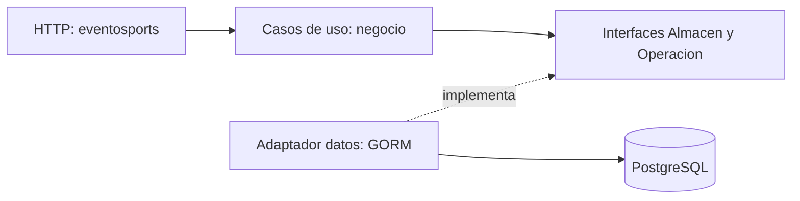

# Decisiones de EventoSports

## Semana 8 · estructura

Elegimos separar HTTP, negocio, datos y modelo en paquetes dentro de `servidor/internal`. Inscripción sigue siendo la entidad principal porque su estado representa la reserva y la verificación de pago; Evento es la entidad relacionada que ya tenía endpoints en el hito 1.

| Carpeta | Responsabilidad | Qué no hace |
|---|---|---|
| `eventosports/` | Rutas, lectura de JSON e ID, sesión y traducción de errores a códigos HTTP | No ejecuta consultas ni decide las transiciones |
| `negocio/` | Casos de uso, validaciones, propiedad, permisos por transición e interfaces del almacén | No importa `net/http`, GORM ni el adaptador de datos |
| `datos/` | GORM, PostgreSQL, consultas, bloqueos, transacciones, migración y semilla | No interpreta peticiones HTTP |
| `modelo/` | Los cinco structs del negocio y sus relaciones | No contiene manejadores ni casos de uso |
| `sesion/` | Los archivos de autenticación del docente: bcrypt, JWT y guardias | No decide las transiciones de Inscripción |
| `configuracion/` | Variables de entorno y lectura de `.env` | No contiene credenciales reales en el código |

El paquete `sesion` conserva la estructura del código entregado por el docente; la separación exigida para la entidad principal está en los cuatro primeros paquetes. No pretendemos que el manejador de login ya sea una arquitectura de capas independiente.



`main.go` conecta las piezas: entrega un `datos.AlmacenGORM` al servicio de negocio y entrega ese servicio al manejador HTTP. Las interfaces se declaran en `negocio/contratos.go`, porque el consumidor define qué necesita de la persistencia. El negocio no importa `datos`.

### Dos archivos que mostraremos

1. **`servidor/internal/eventosports/estado.go`**: recibe el ID y el JSON, llama a `Servicio.CambiarEstado` y escribe la respuesta. No contiene `DB`, `Where`, `First`, `Save` ni una transacción GORM.
2. **`servidor/internal/negocio/estados.go`**: `ValidarCambio` recibe inscripción, evento, actor, estado solicitado, ocupación y hora. Devuelve una decisión de negocio. No recibe `http.Request`, no escribe `http.ResponseWriter` y no usa códigos HTTP ni SQL.

La coordinación de la transacción está en `negocio/servicio.go`; su ejecución concreta y los bloqueos están en `datos/almacen_gorm.go`. El servicio bloquea primero el evento y después la inscripción. La prueba de concurrencia comprueba que dos jugadores no puedan confirmar el último cupo a la vez.

### Errores

El negocio devuelve tipos: `Regla`, `Prohibido`, `Conflicto` o `ErrNoExiste`. La capa HTTP los convierte en 422, 403, 409 y 404 respectivamente. El JSON roto y el ID inválido producen 400 en HTTP. Así, cambiar un código de respuesta no exige modificar la regla de estados.

### Qué cambiaría con otra base

Cambiaríamos el adaptador de `datos/`, las migraciones y la conexión en `main.go`; escribiríamos una implementación de las mismas interfaces. Las reglas de `negocio/estados.go`, los casos de uso y las rutas HTTP podrían mantenerse. La prueba pura de estados sigue ejecutándose sin base de datos.

## Alcance y contrato del Hito 2

- Se conservaron las seis operaciones que ya existían en el mapa del hito 1.
- Se añadió `GET /inscripciones/{id}` para cumplir el mínimo de consultar individualmente la entidad principal. Solo permite al jugador dueño o al organizador de su evento.
- Los modelos de Usuario, Sede, Evento, Inscripción y Pago y todas sus relaciones se migran. `cuentas` es una tabla adicional de sesión, separada de `usuarios`.
- Se documentaron como **`(plan)`** el listado y alta de perfiles, sedes e historial de pagos. No se programaron esos endpoints. Es una extensión del mapa futuro, no una afirmación de que esas rutas ya funcionan.
- No se programaron edición, borrado ni registro de cuentas. Cancelar una inscripción es un cambio de estado.

## Permisos por operación del negocio

El PATCH de Inscripción acepta ambos roles porque la ficha ya permite que un jugador cancele o envíe un comprobante y que un organizador verifique pagos. **La operación demostrada es pasar de `pago_por_verificar` a `confirmada`, exclusiva del organizador dueño.** Ana recibe 403; Luis recibe 200 con el mismo cuerpo. No restringimos todo el PATCH a organizador porque eso quitaría acciones legítimas del jugador.

La transición `cancelada → confirmada` está prohibida aun para Luis: responde 422. La petición está bien formada y el actor es dueño del evento; falla la regla, no la sintaxis ni la autenticación.

## Datos reproducibles y colección

La petición 0 de Bruno hace la preparación antes del turno: inicia ambas sesiones, crea dos eventos futuros, crea y cancela una reserva de respaldo y crea otra cuyo comprobante queda pendiente. La respuesta HTTP principal de la petición 0 es la creación de esa segunda inscripción, 201; su script posterior registra el comprobante. Cada petición auxiliar comprueba su resultado.

Los IDs y los tokens se conservan únicamente en variables de ejecución `bru.setVar`. No se escriben JWT en los archivos `.bru` ni en el entorno versionado. La petición 2 vuelve a iniciar sesión en vivo y obtiene el token usado en 3, 5 y 6. Las peticiones 4 y 5 comparten ID y cuerpo. La 6 usa otro registro ya cancelado. Ejecutar de nuevo la 0 prepara datos nuevos sin borrar datos anteriores.

## Semana 11 · el contenedor

### D1 · Qué entra en la imagen

La imagen final, `eventosports:latest`, tiene solo dos cosas: la base distroless `static-debian13:nonroot` y nuestro binario `/servidor`. En `capas.txt`, la línea `COPY /servidor /servidor` muestra que el binario pesa 21.9 MB; lo demás son los archivos mínimos de distroless. Según `imagenes.txt`, la imagen ocupa 39.6 MB en disco (11.9 MB de contenido). La etapa de compilación, `eventosports:compilacion`, ocupa 1.63 GB (389 MB de contenido), porque lleva Go, el código fuente y las librerías descargadas. Nada de eso pasa a la imagen final.

El proceso arranca como el usuario 65532, sin privilegios (`usuario.txt`).

Sin `.dockerignore`, `docker build .` enviaría también `servidor/.env` y `.env.docker`, y `COPY . .` los dejaría en `/src` de la etapa de compilación, con la clave de la base y el secreto JWT. A la imagen final no llegarían, porque de esa etapa solo se copia el binario; pero quedarían en la imagen intermedia y en la caché de construcción. `contexto.txt` muestra que con `.dockerignore` no entran ni `.env` ni `.git`.

### D2 · Dónde está la base, vista desde el contenedor

Con el mismo `.env` de `go run`, el contenedor respondió «no se pudo conectar a PostgreSQL» (`2_local.txt`). Dentro del contenedor, `localhost` es el propio contenedor, y ahí no hay ninguna base. En `.env.docker` cambiamos solo el host por `host.docker.internal`, que Docker Desktop resuelve como nuestra máquina, donde PostgreSQL 16 escucha en el 5432. No hizo falta cambiar el código.

En un servidor que no sea nuestra máquina, `host.docker.internal` no sirve: `DATABASE_URL` tendría que apuntar al nombre o la dirección del servidor de base de datos. Solo cambia la variable, no el código.

### D3 · Los puertos

Usamos `-p 8080:8080`. El número de la izquierda es el puerto de nuestra máquina, al que llama Bruno. El de la derecha es el del contenedor, donde escucha el servidor, y tiene que coincidir con `PORT` de `.env.docker`. Si no coincide, Docker pasa las peticiones a un puerto donde no escucha nadie y la conexión se corta. El de la izquierda sí se puede cambiar: con `-p 8081:8080`, Bruno tendría que llamar a `localhost:8081`.

### D4 · La hora

En el paso 2.5, `creado` salió con `go run` como `2026-11-12T22:26:53.4017-05:00`, y en el contenedor como `2026-11-13T03:29:48.159934Z`. Son registros distintos, porque la petición 0 crea uno nuevo cada vez, pero el cambio es de formato: `-05:00` es la hora de Ecuador y `Z` es UTC. Las dos formas indican el instante exacto; `22:26:53-05:00` es lo mismo que `03:26:53Z`. El log del contenedor también marca las 03:29 cuando aquí eran las 22:29.

Cambió porque Go escribe las fechas en la zona horaria del sistema. Windows está configurado en la hora de Ecuador; el contenedor distroless no tiene ninguna zona configurada, así que usa UTC.

Decidimos dejarlo así: las fechas siguen siendo correctas porque llevan su desfase, y quien las muestre las convierte a la hora local. En nuestro negocio importaría en la regla de cancelar una inscripción confirmada con 24 horas de anticipación, pero esa regla compara la diferencia entre dos momentos (`e.Inicio.Sub(ahora)`), y la diferencia no depende de la zona.

## Semana 11 · reto: la API y la base, juntas

### D5 · Cómo encuentra la API a la base

En `compose.yaml`, la API usa `db:5432`. `db` es el nombre del servicio de la base, y Compose lo resuelve dentro de la red que crea para el proyecto. El 5432 es el puerto de PostgreSQL dentro de su contenedor. El 5433 era el puerto publicado en nuestra máquina para el contenedor del hito 2; dentro de la red de Compose, la API habla de contenedor a contenedor y no pasa por nuestra máquina, así que no usa ni `host.docker.internal` ni el 5433.

### D6 · El orden de arranque

`depends_on` con `condition: service_healthy` hace que la API espere a que la base pase su `healthcheck`. El `healthcheck` usa `pg_isready` por TCP (`-h 127.0.0.1`): la primera vez, mientras PostgreSQL crea la base, solo atiende por socket y después se reinicia, y así no se da por lista antes de tiempo. También pusimos `restart: unless-stopped` como respaldo.

En nuestras pruebas, con la base vacía, la API arrancó bien las tres veces y sin reinicios (`RestartCount` 0). No llegamos a ver el fallo, porque el `healthcheck` estaba desde el principio.

### D7 · Dónde quedan los datos

En el volumen con nombre `datos` (en Docker, `eventosports-t11_datos`), montado en `/var/lib/postgresql/data`. `docker compose down` borra los contenedores pero no el volumen: había 2 inscripciones antes de bajar y subir, y seguían 2 después. `docker compose down -v` borra también el volumen.

El nombre del volumen lo arma Compose con el nombre del proyecto. Lo comprobamos de la peor forma: un `docker compose down -v` con el `compose.yaml` anterior, cuyo proyecto se llamaba `eventosports-s7`, borró el volumen de la base del hito 2. Por eso este proyecto se llama `eventosports-t11` y su volumen tiene otro nombre.

### D8 · Los secretos

`compose.yaml` no tiene claves: usa `${POSTGRES_PASSWORD}` y `${JWT_SECRET}`, que Compose lee de `servidor/.env`, y `.env` no se sube a Git. Con `:?`, Compose se detiene con un mensaje si falta alguna. `.env.example` dice qué variables hay que definir.

### D9 · Lo que se publica en la máquina

Solo la API, en `${PORT:-8080}:${PORT:-8080}`, para que Bruno siga llamando a `localhost:8080`. La base no se publica: así no choca con el PostgreSQL de Windows (5432) ni con el contenedor del hito 2 (5433), aunque estén encendidos. Para consultarla con `psql`, entramos en su contenedor:

```bash
docker compose exec db psql -U eventosports -d eventosports
```

## Uso de IA

La separación en capas, las pruebas, el contrato, los scripts, la colección y esta documentación se prepararon con asistencia de Codex. Los archivos de tokens y guardia provienen del material docente. La pareja debe revisar las decisiones y explicar el código con sus propias razones. No se fabricaron commits de ningún integrante ni se hizo push automáticamente.

En la semana 11, Claude Code ayudó a construir y probar la imagen, el contenedor y `compose.yaml`, a generar las evidencias y a redactar el borrador de D1 a D9. La pareja debe revisarlas y escribirlas con sus propias razones.
