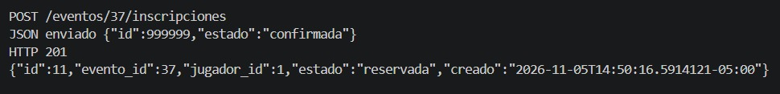

# Fase 2 · Comprobación de los DTO de inscripción

En EventoSports se separó el JSON de la API del modelo `Inscripcion`. Los manejadores usan un DTO de salida para devolver la inscripción con los mismos nombres de campos. El `PATCH` tiene su propio DTO de entrada para solicitar una transición de estado.

## Prueba manual del POST

El 5 de noviembre de 2026 se envió una petición autenticada a `POST /eventos/37/inscripciones` con este cuerpo:

```json
{"id": 999999, "estado": "confirmada"}
```

El servidor respondió **HTTP 201**, asignó el ID **11** y guardó el estado inicial **reservada**. La prueba confirma que el servidor asigna el ID y fija el estado inicial aunque el cliente envíe otros valores.


