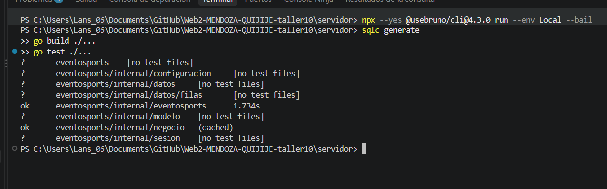

# Fase 3 · Dos consultas de inscripción con sqlc

| Paso | Qué se hizo |
| --- | --- |
| 3.1 · Configuración | [sqlc.yaml](../../../servidor/sqlc.yaml) indica que se usa PostgreSQL, dónde se leen el esquema y las consultas y dónde se genera el código Go. |
| 3.2 · Esquema | [schema.sql](../../../servidor/db/schema.sql) describe las columnas de `inscripciones` que sqlc necesita conocer. GORM sigue creando y migrando la tabla al iniciar el servidor. |
| 3.3 · Consultas | [consultas.sql](../../../servidor/db/consultas.sql) define `BuscarInscripcion` para leer una fila por ID y `GuardarEstadoInscripcion` para actualizar únicamente el estado y devolver cuántas filas cambió. `sqlc generate` convierte esas consultas en [funciones Go](../../../servidor/internal/datos/filas/consultas.sql.go). |
| 3.4 · Adaptador | [almacen_sqlc.go](../../../servidor/internal/datos/almacen_sqlc.go) llama a las dos funciones generadas. Si falta una inscripción, devuelve el error de negocio que se traduce a HTTP 404. El cambio de estado se ejecuta dentro de la transacción que abre GORM, junto con las operaciones de pago. |
| 3.5 · Conexión | [main.go](../../../servidor/main.go) entrega `AlmacenSQLC` al servicio. El servicio conserva la interfaz `Almacen` y las demás operaciones siguen usando GORM. |

## Qué muestra la captura

Los comandos se ejecutaron desde `servidor/`.

- `sqlc generate` generó el código de las consultas.
- `go build ./...` compiló el servidor y sus paquetes.
- `go test ./...` mostró `ok` en `eventosports` y `negocio`. La indicación `[no test files]` corresponde a paquetes que no tienen pruebas propias.

